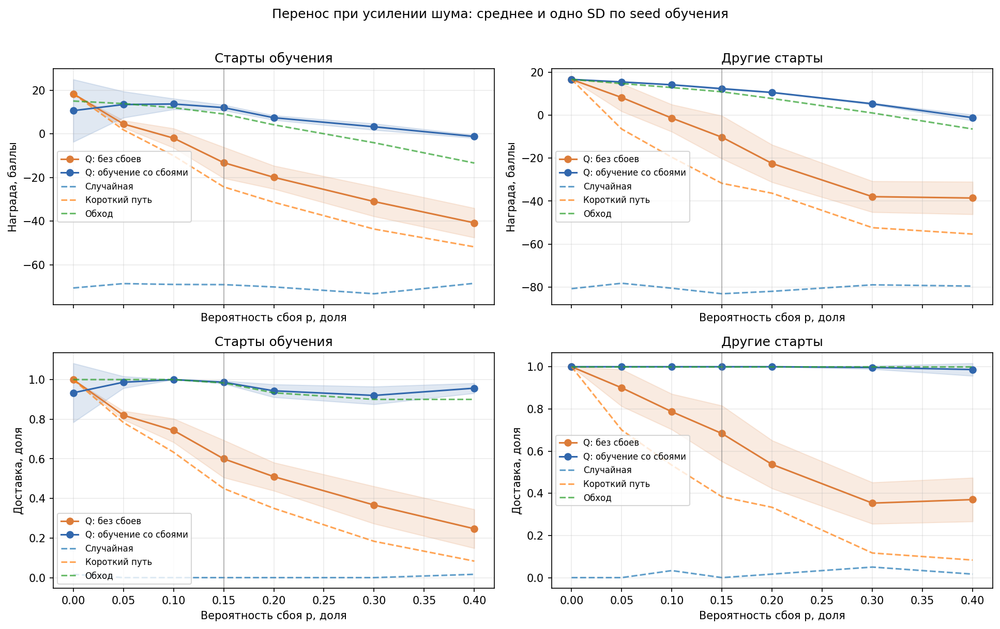
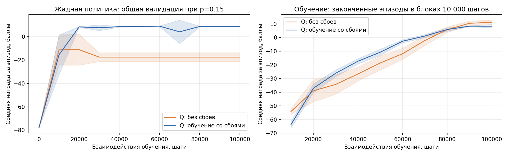
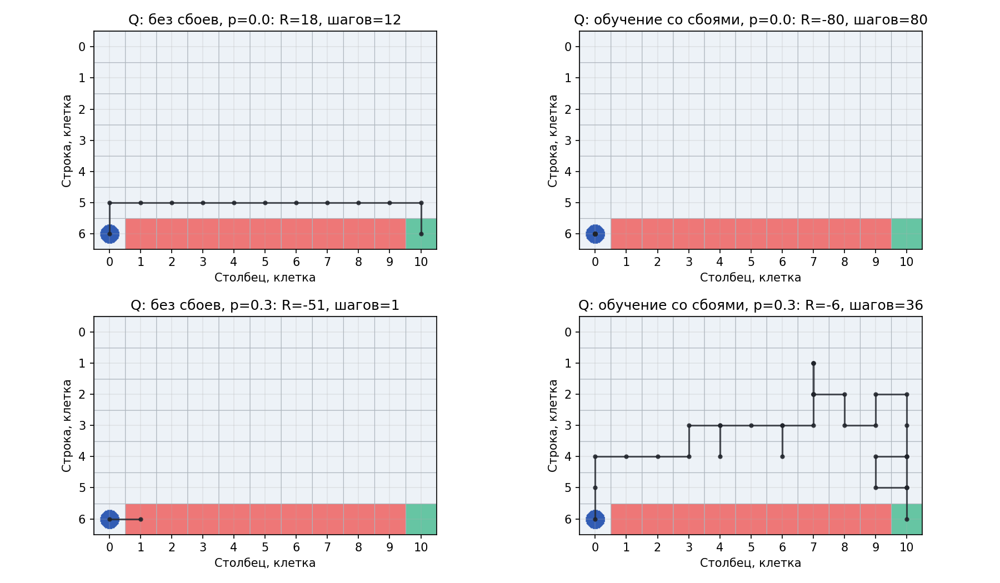
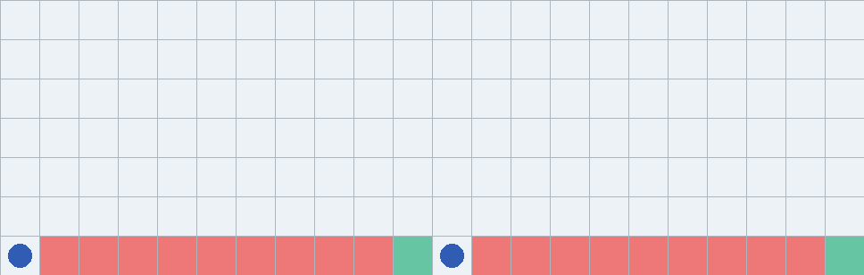

# Цена устойчивости: робот со сбоями привода

Курсовое задание по обучению с подкреплением, трек 2. **Шилов К. М.**

Исследуем, помогает ли обучение при 15% случайных сбоев действий доставлять груз
при 30% сбоев и чем приходится жертвовать в отсутствие шума. Реализованы собственная
среда Gymnasium и табличный Q-learning. GPU и внешние данные не нужны.

Основной отчёт с кодом и сохранёнными результатами:
[Шилов_КМ_RL_course_task.ipynb](Шилов_КМ_RL_course_task.ipynb).
Ноутбук выполнен на Python 3.11.11. Эксперимент занимает
около **одной минуты** на моем компьютере. Точное время записано в [results/provenance.json](results/provenance.json).

## Постановка и гипотеза

Робот перемещается по сетке 7 x 11. Цель находится в нижнем правом углу, опасная
зона занимает нижнюю строку между стартом и целью. Действие - шаг в одну из четырёх
сторон. При сбое оно поворачивается на 90 градусов влево или вправо с равными
вероятностями. Попытка выйти за карту оставляет робота на месте.

Наблюдение - номер клетки. Каждый переход стоит 1 балл, доставка дополнительно
даёт 30, авария отнимает 50. Доставка или авария завершают задачу; после 80 шагов
эпизод обрывается внешним лимитом. Q-learning обнуляет продолжение только при
истинном завершении, сохраняя его после обрыва по времени.

Гипотеза: обучение со сбоями поощряет безопасный обход и повышает награду и долю
доставок при усилении шума, но может ухудшить работу без сбоев. Основная метрика -
разность средних наград при `p=0.30`; доля доставок проверяет практический эффект.
Длина пути, аварии, таймауты и доля позиций рядом с опасной зоной объясняют поведение.

## Контролируемый эксперимент

- Два условия обучения: `dry` (`p=0`) и `noisy` (`p=0.15`). Меняется только вероятность сбоя.
- По 100 000 переходов на запуск; пять seed: `11, 23, 37, 53, 71`. Всего 1 000 000 переходов.
- Общие параметры: `alpha=0.12`, `gamma=0.98`, epsilon от `0.60` до `0.05` за первые 80% бюджета.
- Проверка при `p = 0, 0.05, 0.10, 0.15, 0.20, 0.30, 0.40` без обновления Q и исследования действий.
- Два набора по три старта: обучающие позиции и другое начальное распределение на той же карте.
- По 20 эпизодов на позицию: 60 на набор стартов, 120 на уровень шума для одной политики.
- Тестовые seed общие для всех стратегий, отделены от обучения и промежуточной валидации.
- Оценивается последний шаг обучения; тест не используется для выбора модели или гиперпараметров.
- Три ориентира: случайные действия, ручной короткий маршрут и ручной безопасный обход.

Параметры и основной стресс-тест зафиксированы в
[experiment_config.json](experiment_config.json). Валидационные эпизоды не входят
в бюджет обучающих переходов и используются только для кривой обучения.

## Результаты

При `p=0.30`, с равными весами двух наборов стартов:

| Стратегия | Награда, баллы | Доставки, % | Аварии, % | Шагов при успешной доставке |
|---|---:|---:|---:|---:|
| Q-learning без сбоев | -34.48 | 36.00 | 64.00 | 18.51 |
| Q-learning со сбоями | **4.26** | **95.83** | 4.17 | 23.31 |
| Ручной обход | -1.53 | 95.00 | 5.00 | 28.93 |
| Ручной короткий маршрут | -48.01 | 15.00 | 85.00 | 16.78 |
| Случайные действия | -76.13 | 2.50 | 76.67 | 66.33 |

Для каждого обучаемого варианта средние получены по пяти агентам на одинаковых
120 эпизодах; у эвристик - одна политика на тех же 120 сценариях. Таймауты у случайной
стратегии составляют 20.83%, у остальных при этом уровне шума отсутствуют. Длина в
последнем столбце вычислена только по успешным эпизодам, без коротких аварий.

Парная разность наград `noisy - dry`: **+38.75 балла**, SD между пятью seed - **6.39**,
диапазон от +32.98 до +46.25. Разность положительна во всех пяти парах. Доставки
увеличились на **59.83 процентного пункта**. Это поддерживает гипотезу в выбранных
условиях. Преимущество по доставкам перед ручным обходом мало; уверенное превосходство
над этой эвристикой не установлено.



Линии обученных агентов - среднее по пяти seed, полосы - одно выборочное SD по
средним этих агентов. Это не доверительные интервалы. У эвристик нет seed обучения,
поэтому такие полосы для них не строятся. Полная таблица:
[results/metrics_by_seed.csv](results/metrics_by_seed.csv).



Слева - отдельная общая валидация при `p=0.15`, справа - награда законченных
обучающих эпизодов в блоках по 10 000 переходов. Правые кривые получены в разных
динамиках и включают исследование действий, поэтому напрямую сравнивать их как
финальное качество нельзя.

## Что объясняет результат

При `p=0.30` доля позиций рядом с опасной зоной снизилась с **32.26% до 6.87%**,
а доля аварий - с 64.00% до 4.17%. Это согласуется с выбором более безопасных маршрутов.

Без сбоев средняя награда снизилась с 17.50 до 13.63 балла, а доля доставок -
со 100.00% до 96.67%. Потеря объясняется не только длиной обхода: агент `noisy`,
seed `11`, в клетке `(6, 0)` выбирает движение влево в стену. При ненулевом шуме
случайный поворот вверх позволяет выйти из угла; при `p=0` агент остаётся там до
лимита. Остальные четыре агента выбирают движение вверх. Разбор:
[results/wall_analysis.csv](results/wall_analysis.csv).

Это неожиданный вид зависимости от условий обучения: агент использует шум как
ресурс движения. Обучение с шумом помогает при его усилении, но не гарантирует
надёжность при исчезновении шума. Протокол после обнаружения этой ошибки не менялся.



Анимация при `p=0.30`: слева агент без сбоев при обучении, справа - со сбоями.
Первый seed обучения и тестовый сценарий выбраны заранее; завершившийся эпизод
остаётся на последнем кадре.



## Ограничения

Одна карта, точные координаты и независимые перпендикулярные сбои упрощают задачу.
Новые стартовые позиции могли посещаться при обучении; результат относится к
другому начальному распределению на знакомой карте. Успех на новой карте не проверялся.
Награда задаёт условный компромисс между скоростью и безопасностью; это не гарантия
отсутствия аварий. Постоянный шаг Q-learning и конечный бюджет не гарантируют оптимальность.

Пять seed показывают изменчивость обучения. Общие тестовые воздействия и эпизоды
одного агента нельзя считать независимыми повторениями обучения. При `p=0`
20 повторов одной начальной позиции дают одинаковую траекторию детерминированной
политики; число таких повторов не увеличивает объём независимой информации.
SD не учитывает всю неопределённость конечного теста. Небольшие различия между
обученным агентом и ручным обходом требуют дополнительных сценариев.

Следующие проверки могли бы включать другие карты, коррелированный шум и другие
цены аварии. Они не входят в выполненный эксперимент.

## Запуск

Рекомендуется Python 3.11. Откройте терминал в каталоге проекта.
Существующее окружение пользователя:

```powershell
conda activate diplom
python -m jupyter lab
```

Для отдельного окружения на Windows:

```powershell
python -m venv .venv
.\.venv\Scripts\python.exe -m pip install -r requirements.txt
.\.venv\Scripts\python.exe -m jupyter lab
```

Выберите ядро созданного окружения и выполните `Restart Kernel and Run All Cells`.
Если ядро не отображается, зарегистрируйте его:

```powershell
.\.venv\Scripts\python.exe -m ipykernel install --user --name mephi-rl --display-name "MEPHI RL"
```

Проверки среды, из активированного окружения:

```powershell
python -m unittest -v test_environment.py
```

В Google Colab выберите CPU, загрузите ноутбук, `warehouse_env.py` и
`experiment_config.json` в одну папку. В отдельной первой ячейке установите:

```python
%pip install numpy==2.2.5 pandas==2.3.3 matplotlib==3.10.7 gymnasium==1.4.0 Pillow==12.0.0
```

При запросе Colab перезапустите сеанс, затем выполните все ячейки.
Повторный запуск перезаписывает `results/`; для сравнения разных протоколов заранее
сохраните предыдущую копию. Отображённые числа относятся к приложенному протоколу.

